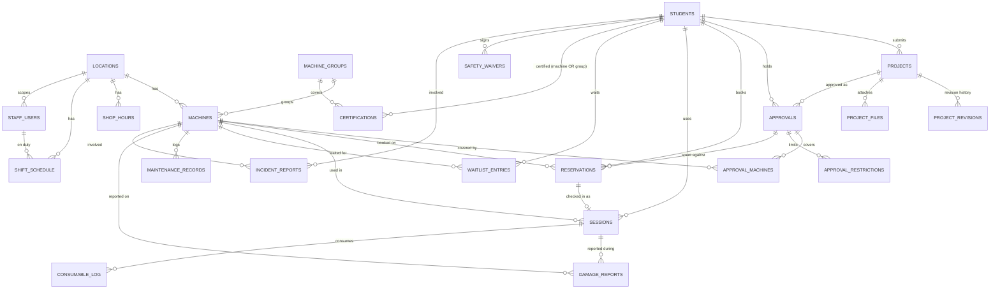

# Data model

All timestamps are stored in UTC and displayed in `America/Los_Angeles` (configurable). `location_id` exists on
machines, shop hours, shifts and staff so a second shop can be added later (one location by default).

Standalone tables: `email_verifications` (hashed 6-digit codes), `rotating_codes` (shop presence code),
`settings` (key → JSON), `audit_log` (append-only; enforced by an ORM guard and, on Postgres, a trigger),
and infrastructure tables `rate_events`, `idempotency_keys`, `email_outbox`, `file_blobs`.

## Key rules encoded in the schema
* `students.email` unique and lower-cased: the identity key (SSO later only has to produce a verified email).
* `approvals.number` unique (`APR-2026-0042`); `reservations.ref` unique (`RSV-7K3Q9F`, no ambiguous characters).
* `sessions`: partial unique indexes allow at most one *active* session per machine and per student (double-scan safe).
* `certifications`: exactly one of `machine_id` / `group_id`.
* `reservations.end_at > start_at`; overlap prevention is done under a row lock on the machine.
* `shop_hours`: either a weekly row (`weekday`) or a dated exception (`on_date`), never both.
